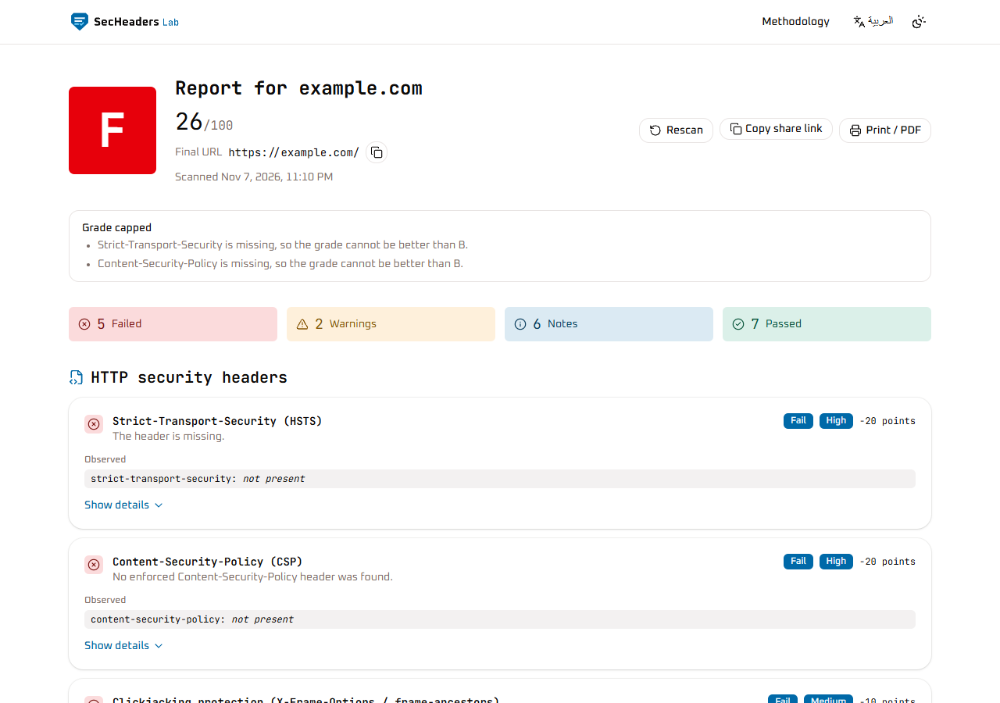
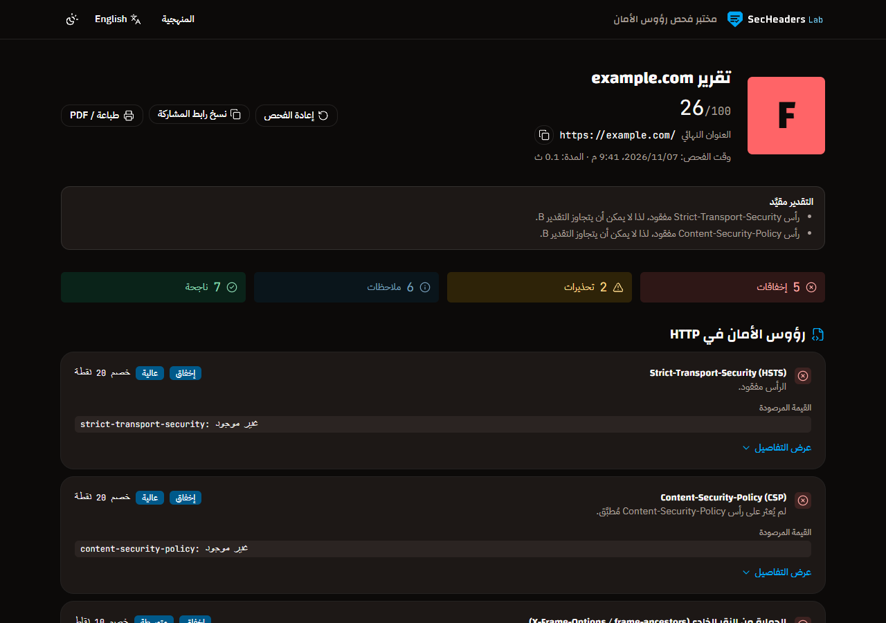
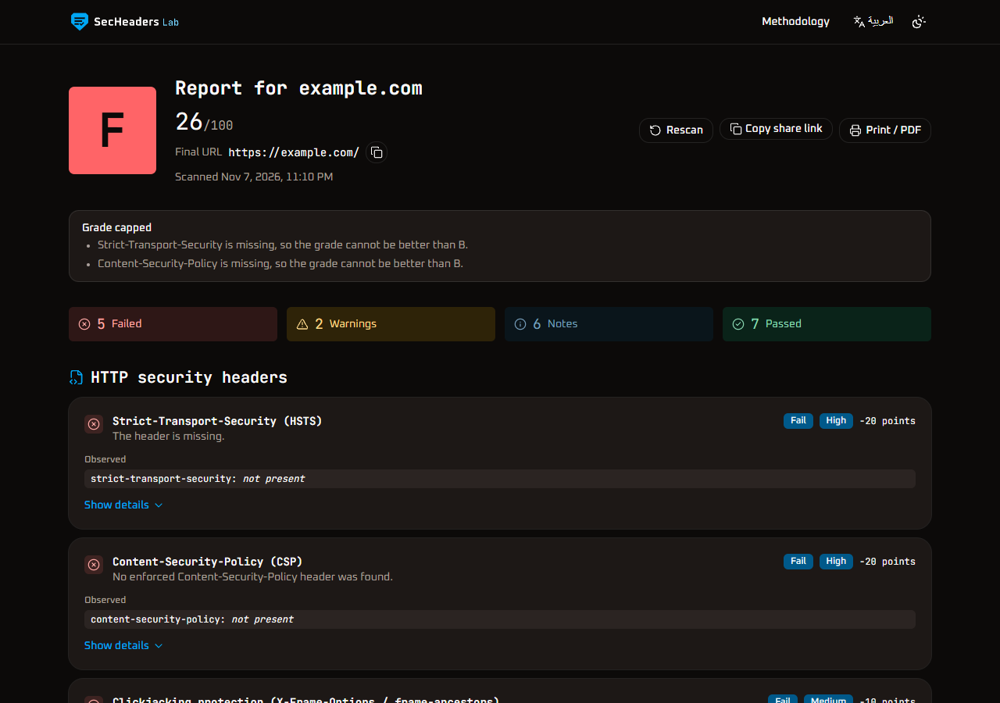
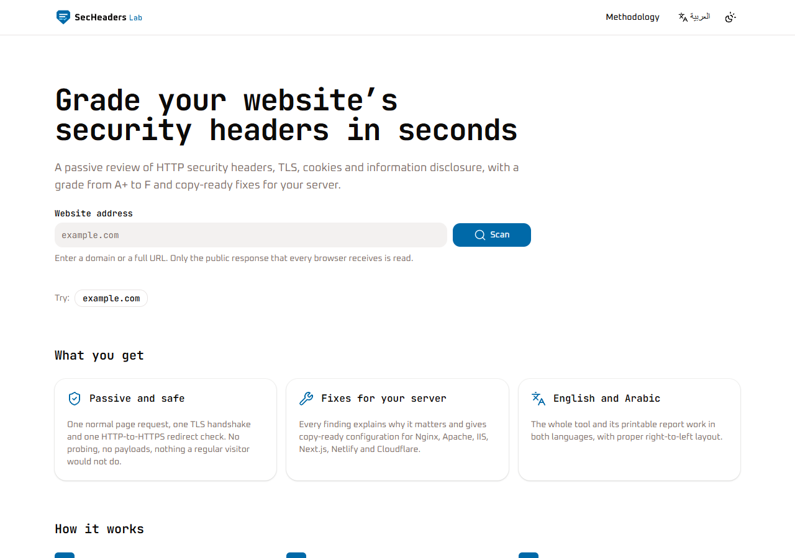
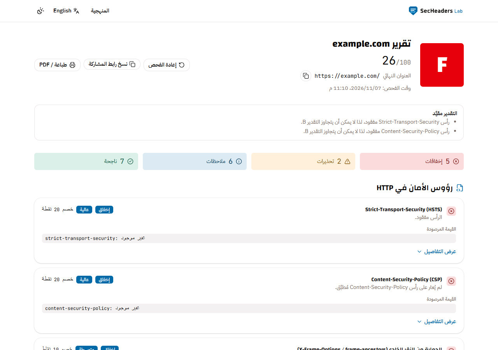
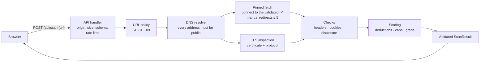

<p align="center">
  
</p>

<p align="center">
  <strong>Passive website security review: HTTP security headers, TLS, cookies and information disclosure,<br>
  with a score, a grade from A+ to F, and copy-ready fixes for your server.</strong>
</p>

<p align="center">
  <a href="https://secheaders-lab.netlify.app/en"><strong>Live demo</strong></a> ·
  <a href="https://secheaders-lab.netlify.app/en">English</a> ·
  <a href="https://secheaders-lab.netlify.app/ar">العربية</a>
</p>

<p align="center">
  <a href="https://github.com/Mohammed-Alrabai/secheaders-lab/actions/workflows/ci.yml"></a>
  <a href="https://github.com/Mohammed-Alrabai/secheaders-lab/actions/workflows/codeql.yml"></a>
  <a href="LICENSE"></a>
</p>

---

**EN** — SecHeaders Lab reads the response a website already serves to every visitor (one normal `GET` and a
TLS handshake), explains each finding in plain language, and gives you the exact configuration to fix it on
Nginx, Apache, IIS, Next.js, Netlify or Cloudflare. It never probes, crawls or attacks anything.

**AR** — SecHeaders Lab يفحص الاستجابة التي يرسلها الموقع لأي زائر (طلب `GET` عادي ومصافحة TLS) دون أي فحص
هجومي، ثم يعطي درجة من A+ إلى F، ويشرح كل ملاحظة، ويقدّم إعدادات جاهزة للنسخ لإصلاحها على خادمك. الواجهة
والتقرير متاحان بالعربية والإنجليزية مع دعم كامل للاتجاه من اليمين إلى اليسار.



| Arabic, dark | English, dark |
|---|---|
|  |  |

<details>
<summary>More screenshots</summary>




</details>

## Features

- **21 checks** across four areas: security headers (HSTS, CSP, framing, `X-Content-Type-Options`,
  `Referrer-Policy`, `Permissions-Policy`, COOP, legacy `X-XSS-Protection`, duplicates), TLS (availability,
  certificate validity and expiry, protocol version, http→https redirect), cookies (`Secure`, `HttpOnly`,
  `SameSite`, `__Host-`/`__Secure-` prefixes) and information disclosure (`Server`, `X-Powered-By`,
  ASP.NET version headers).
- **Score and grade** from a published, versioned model: deductions per rule, grade caps for serious gaps
  (no HTTPS, invalid certificate, old TLS, missing HSTS or CSP) and strict A+ requirements.
- **Copy-ready remediation** for Nginx, Apache, IIS (`web.config`), Next.js, Netlify and Cloudflare.
- **Evidence for every finding**: the observed header value, why it matters and references (MDN, OWASP).
- **Shareable results** (`/en/scan?url=example.com`), redirect chain and sanitized raw headers.
- **Print / Save as PDF** report: A4, page numbers, failing findings expanded, your platform's fixes only.
- **Bilingual** English and Arabic with proper RTL, light and dark themes, WCAG 2.2 AA.
- **Transparent methodology** page generated from the same rule and scoring code the scanner uses.
- **Private by design**: no accounts, no analytics, no stored scans, no third-party scripts or fonts.

## How it works



1. The browser posts the URL to `/api/scan`. The handler checks origin, content type, body size and schema,
   and applies a per-client rate limit.
2. The URL passes a strict policy (scheme, port, credentials, length, host syntax, no IP literals, no internal
   names). The host is resolved and **every** address must be public unicast.
3. The page is fetched with a connector pinned to the validated IP, so DNS cannot change between the check and
   the connection. Each redirect is validated again from scratch; the body is never read.
4. A separate TLS handshake reads the certificate and negotiated protocol.
5. Pure, individually tested rule functions produce findings; the scoring module turns them into a score and
   grade. The result is schema-validated before it leaves the server and is never stored.

Full details: [architecture](docs/02-ARCHITECTURE.md) · [scoring specification](docs/04-SCORING-SPEC.md) ·
[decision log](docs/DECISIONS.md).

## Security design

A tool that fetches user-supplied URLs is an SSRF target by definition, so the scanner is built defensively
first. Every control below is specified in [docs/03-SECURITY-CONTROLS.md](docs/03-SECURITY-CONTROLS.md) and
covered by tests.

**SSRF defenses**

- Strict URL policy: `http`/`https` only, ports 80/443 only, no credentials, no IP literals, no single-label
  or reserved internal names, length and character limits.
- Every resolved address must be public unicast. Private, loopback, link-local, CGNAT, multicast, documentation,
  benchmark and reserved ranges are blocked, plus IPv4-mapped/embedded IPv6 forms (6to4, Teredo, NAT64) and any
  IPv6 outside `2000::/3`.
- **DNS-rebinding protection**: the socket connects to the exact IP that was validated, with the real host name
  used only for TLS SNI and certificate checks.
- Redirects are followed manually (max 5), and each hop is re-validated end to end.
- `GET` only, fixed request headers, no cookies, no body read, connect/header timeouts and a total scan budget.
- A 24-case SSRF test matrix plus extra cases run against local servers with mocked DNS. A network guard makes
  any unit or integration test fail if it tries to reach the real internet.

**The site itself scores A+**

- Per-request nonce Content-Security-Policy with `'strict-dynamic'`, no `'unsafe-inline'` scripts, no eval
  (verified with zero violations in the browser and checked by an end-to-end test).
- HSTS with preload, `X-Frame-Options: DENY` and `frame-ancestors 'none'`, `nosniff`, strict referrer policy,
  locked-down Permissions-Policy, COOP and CORP. The API and static brand files get even stricter policies.
- An end-to-end test scans the headers the production server actually sends and requires 100 / A+.
- Untrusted data from scanned sites is rendered only as text: header bytes are re-decoded safely, bidi and
  control characters are neutralized, values are truncated, and cookie values are redacted.

**API hardening**: same-origin check, `application/json` only, 4 KB body limit, strict schema (unknown fields
rejected), rate limiting, `Cache-Control: no-store`, and error codes that never expose stack traces, resolved
IPs or upstream messages. Logs contain only the outcome, duration and target host name.

**Supply chain**: exact-pinned dependencies with a short approved list, a pnpm minimum release age, CI with
CodeQL, Semgrep (OWASP Top 10, TypeScript, Next.js, secrets), Gitleaks and `pnpm audit`, GitHub Actions pinned to
commit SHAs and least-privilege workflow tokens.

Found a vulnerability? See [SECURITY.md](SECURITY.md).

## Scoring in short

Every site starts at 100. Failed and warned rules deduct points; informational notes never do.

| Grade | Score | Extra requirement |
|---|---|---|
| A+ | ≥ 95 | No failed findings, HSTS `max-age` of at least one year, and a passing CSP |
| A | ≥ 90 | |
| B | ≥ 80 | |
| C | ≥ 70 | |
| D | ≥ 60 | |
| F | < 60 | |

Caps limit the grade whatever the score: no HTTPS or an invalid certificate → F, TLS below 1.2 → C, missing
HSTS or CSP → B. The full model, with every rule and weight, is in
[docs/04-SCORING-SPEC.md](docs/04-SCORING-SPEC.md) and on the in-app Methodology page.

## Tech stack

| Area | Choice |
|---|---|
| Framework | Next.js 16 (App Router, Node.js runtime), React 19, TypeScript (strict) |
| UI | Tailwind CSS 4, shadcn/ui on Base UI, Lucide icons, self-hosted fonts |
| i18n | next-intl (English default, Arabic RTL) |
| Scanner | undici (pinned connector), Node `tls` and `dns`, ipaddr.js, tldts (Public Suffix List), Zod |
| Tests | Vitest (unit + integration, coverage), Playwright + axe-core (end to end, accessibility) |
| Quality | ESLint (typescript-eslint strict, eslint-plugin-security), Prettier |
| CI | GitHub Actions, CodeQL, Semgrep, Gitleaks, Dependabot |
| Hosting | Netlify |

## Run it locally

Requirements: Node.js 24 and pnpm 12 (through Corepack, which ships with Node.js).

```bash
corepack pnpm install
```

```bash
corepack pnpm dev
```

Open <http://localhost:3000>. Copy `.env.example` to `.env.local` to change the scan time budget or rate
limit; no secrets are needed.

To run the production build:

```bash
corepack pnpm build
```

```bash
corepack pnpm start
```

## Testing

| Command | What it runs |
|---|---|
| `pnpm lint` | ESLint with zero warnings allowed |
| `pnpm typecheck` | Route type generation and `tsc --noEmit` |
| `pnpm test` | 1,173 unit and integration tests (local servers, mocked DNS, no internet) |
| `pnpm test:coverage` | Same, with coverage thresholds (scanner core ≥ 95%; currently ~99%) |
| `pnpm test:e2e` | 46 Playwright tests: user flows, error states, print, axe on 20 page/locale/theme combinations, CSP, keyboard-only use, own headers A+ |
| `pnpm check` | Lint, typecheck, coverage and build together |

Before the first end-to-end run, install a browser with `pnpm exec playwright install chromium`, or reuse an
installed Edge or Chrome by setting `PLAYWRIGHT_CHANNEL` to `msedge` or `chrome`.

Lighthouse on the live site (mobile profile), home and methodology pages in both languages:
Performance 99–100, Accessibility 100, Best Practices 100, SEO 100.

## Project documentation

The project was planned before it was built. The [docs](docs) folder holds the product requirements,
architecture, security controls, scoring specification, engineering standards, UI and i18n guide, design
system, implementation plan and an ADR-style [decision log](docs/DECISIONS.md). [PROGRESS.md](PROGRESS.md)
records what was delivered in each phase.

## Roadmap

Possible next steps after v1.0:

- DNS email security (SPF, DMARC) and `/.well-known/security.txt` checks.
- CORS, COEP and CORP scoring.
- Browser-only scan history, comparing two scans and JSON download.

## Disclaimer

SecHeaders Lab performs a passive, read-only inspection of publicly served responses. It is not a penetration
test, and results are informational, not a formal compliance assessment. Only scan sites you own or are
authorized to assess.

## License

[MIT](LICENSE) © Mohammed Alrabai
