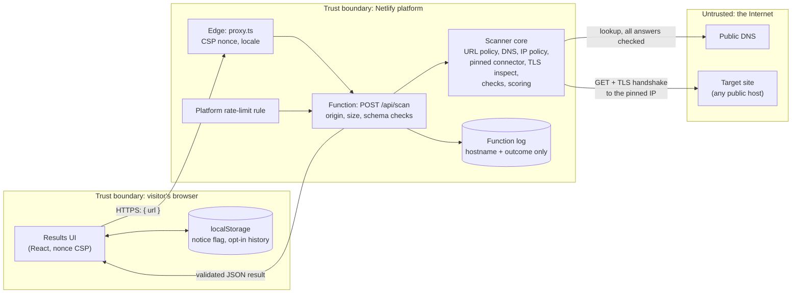
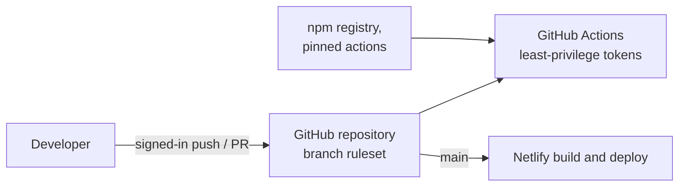

# 09 — Threat Model

> Scope: SecHeaders Lab as deployed (Next.js on Netlify) and its repository. Method: data-flow
> diagram, trust boundaries, then STRIDE per component. Every mitigation points to a control in
> [`03-SECURITY-CONTROLS.md`](03-SECURITY-CONTROLS.md) (SC-xx) or a decision in
> [`DECISIONS.md`](DECISIONS.md) (ADR-xxx). Last reviewed 2026-11-09 (v1.2 work, ADR-047).

## 1. System overview

A visitor submits a website address. The server validates it, performs one passive scan of that
public site (one `GET` with up to five validated redirects, a TLS handshake and an `http://` redirect
check), scores the response headers and returns a JSON result that the browser renders. Nothing is
stored on the server. The browser may keep two small preferences and, only if the visitor turns it
on, a scan history (ADR-045).

## 2. Data flow and trust boundaries

| Boundary | What crosses it | Why it matters |
|---|---|---|
| Browser → Netlify | The address to scan | Attacker-controlled input to a server that makes outbound requests (SSRF) |
| Scanner → Internet | DNS lookups, one `GET` per hop, a TLS handshake | Destinations are chosen by the visitor; responses are attacker-controlled |
| Netlify → Browser | The scan result | Contains strings chosen by the scanned site (headers, URLs, issuer) |
| Repository → Netlify | Code and dependencies | Supply-chain path to production |

## 3. Assets

| Asset | Security property |
|---|---|
| Netlify network position (internal services, metadata endpoints, other tenants) | Must never be reachable through the scanner |
| Availability of the scan service | Must not be exhausted by one client |
| Visitors' privacy (who scanned what) | No accounts, no tracking, minimal logs |
| Integrity of the rendered report | Target data must not execute or mislead |
| Repository, CI tokens and deploy pipeline | Must not be tampered with |

## 4. STRIDE analysis

### 4.1 Scan API and scanner core (highest risk)

| Threat | STRIDE | Mitigation | Residual risk |
|---|---|---|---|
| SSRF to private, loopback, link-local or cloud-metadata addresses | E, I | Scheme, credential, port and IP-literal rejection (SC-02…SC-06, ADR-005); reserved names (SC-08); every DNS answer must be public (SC-11, SC-12, ADR-041) | Low. New special-purpose ranges need the IANA fixture refreshed (ADR-041) |
| DNS rebinding between check and connect | E | Socket dials the validated IP; hostname kept only for SNI and `Host` (SC-13, SC-14) | Low |
| Redirect to an internal or reserved target | E | Manual redirects, max 5, each hop re-validated from scratch (SC-17, ADR-019) | Low |
| Plaintext leak of the submitted path or query | I | HTTPS→HTTP fallback requests only `http://<host>/` (ADR-013, ADR-039) | Low |
| Requests to unrelated third-party sites | — (scope) | The http→https probe stops before any cross-site hop (ADR-039); the page fetch follows redirects as a browser would | Accepted: the main fetch may reach a site the target redirects to |
| Resource exhaustion via slow or huge responses | D | Connect, header and whole-scan timeouts (SC-18); body never read (SC-19); header limits (SC-20) | Low |
| Abuse of the service as a request amplifier | D | Platform rate limit, verified live (SC-24, ADR-024); passive single `GET` (ADR-001) | Medium: the in-process limiter is per instance and best-effort (ADR-024) |
| Weak TLS on the inspection socket used for the page fetch | T, I | Page fetch keeps full validation (SC-21); permissive settings only on the read-only inspection socket (ADR-018) | Low |
| Oversized, malformed or aborted request bodies | D | JSON only, 4 KB limit enforced while streaming, strict schema (SC-23); stream errors return a typed 400 (ADR-039) | Low |
| Cross-site use of the API from another origin | S | `Origin` must equal the site origin when present (SC-25, ADR-025); no CORS headers | Accepted: non-browser clients without `Origin` are allowed by design (SC-25) |
| Leaking internals in errors or results | I | Fixed public error codes (SC-26); output schema strips unexpected fields (SC-28); cookie values redacted (ADR-015) | Low |
| Logging visitor data | I, Repudiation | Logs keep hostname, outcome and duration only (SC-37); no persistence (SC-38) | Accepted: the platform itself processes IP addresses (disclosed in the Privacy Policy) |

### 4.2 Browser UI

| Threat | STRIDE | Mitigation | Residual risk |
|---|---|---|---|
| XSS through scanned header values, URLs or issuer names | T, E | All target data rendered as text (SC-29); control and bidi characters stripped (SC-31); redirect URLs are not links (SC-30); no `dangerouslySetInnerHTML` | Low |
| Script injection into the app itself | T, E | Per-request nonce CSP with `'strict-dynamic'` (ADR-030); no third-party scripts; Zod runs jitless so no `eval` (ADR-033) | Low. Inline style attributes are allowed (ADR-009) |
| Clickjacking | T | `frame-ancestors 'none'` and `X-Frame-Options` (`03` §6) | Low |
| Tampered history in `localStorage` | T | History is schema-validated on read; invalid data is discarded (ADR-045); only the visitor's own browser can write it | Low |
| Exposure of the history on a shared device | I | History is off by default and can be deleted in one click (ADR-045) | Accepted, disclosed in the Privacy and Cookie Policies |

### 4.3 Supply chain and delivery

| Threat | STRIDE | Mitigation | Residual risk |
|---|---|---|---|
| Malicious or compromised dependency | T, E | Exact pins and frozen lockfile (SC-32); Dependabot (SC-33); `pnpm audit`, CodeQL, Semgrep (SC-34); pnpm's minimum release age policy | Medium: a compromised pinned version would still need review to catch |
| Tampered GitHub Action | T, E | Actions pinned to full commit SHAs (SC-33) | Low |
| Leaked secrets in the repository | I | No secrets in code; Gitleaks in CI (SC-34) | Low |
| Over-privileged CI token | E | `contents: read` by default, elevated per job only (SC-36) | Low |
| Unreviewed change reaching production | T | Branch ruleset on `main`: pull requests, required checks, no force push or deletion | Medium: repository admins can bypass the ruleset |
| Responsible disclosure gap | — | `SECURITY.md` with GitHub private vulnerability reporting (SC-35) | Low |

## 5. Out of scope

- Attacks on Netlify's or GitHub's own infrastructure.
- Compromise of a visitor's device or browser.
- The security of the sites being scanned: SecHeaders Lab only reports what they send.

## 6. Review triggers

Update this document when any of these change: a new outbound request type (for example DNS
record checks or `security.txt`), a new storage location, a new third-party service, a change to
the API contract, or a new deployment platform.
